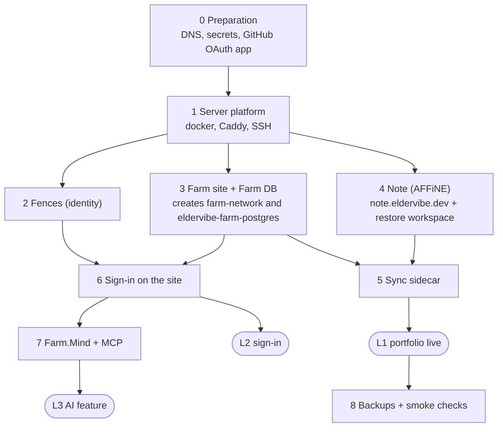

# Deployment plan: eldervibe.dev up, syncing, serving portfolio and AI

Goal: get the whole system running in production first, then enhance the product. This document is the
order of operations, the preparation each step needs, and the gaps that must be closed before the first
deploy. Facts below were read from the workflows and scripts on 2026-10-11; items marked **GAP** are
things that do not exist yet or that I could not verify without the VPS.

Related: [SYSTEM-OVERVIEW](SYSTEM-OVERVIEW.md) (diagrams), [ARCHITECTURE](ARCHITECTURE.md) (sync internals),
[DISCUSSION-NOTES](DISCUSSION-NOTES.md) (decisions).

## 1. Definition of done

| Level | What works | Needed from this plan |
| --- | --- | --- |
| **L1 Portfolio live** | `eldervibe.dev` serves the site from the Farm database; the database is filled by the sync from `note.eldervibe.dev` (AFFiNE) | Phases 0-5 |
| **L2 Sign-in** | "Sign in" on the site works through Fences (`identity.eldervibe.dev`) | Phase 6 |
| **L3 AI feature** | An AI client connects to `https://eldervibe.dev/mcp`, signs in through the browser and reads/writes memory | Phase 7 (needs build work, see GAP list) |

Ship L1 first, then L2, then L3. Each level is independently useful and independently reversible.

## 2. Dependency order

Phases 2, 3 and 4 are independent of each other and can run in parallel once Phase 1 is done. The sidecar
needs both the Farm database (Phase 3) and AFFiNE (Phase 4).

## 3. What exists today

| Piece | Branch | Deploy mechanism | State |
| --- | --- | --- | --- |
| Server provisioning | main | `provision-server.yml` (manual) | exists |
| Caddy ingress | main | `deployment/deploy-caddy-service.sh`: one fragment per domain (`/etc/caddy/sites/<domain>.caddy`), one upstream | exists, single upstream only |
| Farm site + DB | main | `build-deploy-farm.yml` then `Farm/scripts/deploy-farm.sh`: creates network `farm-network`, container `eldervibe-farm-postgres` (loopback port 4554), site on 8180 | exists |
| Fences | sub/identity | `bootstrap-fences.yml` (certificates and env, once), `deploy-fences.yml`, `update-fences-env.yml` | exists |
| Note (AFFiNE) | sub/note | `deploy-note.yml` (manual): tars `Streams/DaHang/.docker/selfhost`, `DaHangCustom.sh` brings it up and writes the Caddy fragment | exists |
| Sync sidecar | sub/note | `deploy-note-sync.yml` (manual) | new, never run on the VPS |
| Farm.Mind | main | Dockerfile only | **GAP**: no workflow, no wrapper script, no route |
| Backups | main | `backup-all.yml` | exists; covers Farm DB, Fences, AFFiNE, Seafile, mail |

## 4. Gaps to close before the first deploy

Numbered so they can be tracked. "Branch" is where the change belongs.

| # | Gap | Why it matters | Branch |
| --- | --- | --- | --- |
| G1 | **Farm DB password.** **Done (main):** `deploy-farm.sh` generates it once at `/etc/farm/postgres.password` (root, 0600), reuses it, and applies `ALTER USER` only when it is new. No GitHub secret is needed. | The sidecar joins `farm-network`; read the password with `sudo cat /etc/farm/postgres.password` after the Farm deploy and put it in `sync.env`. | main (done) |
| G2 | **Farm auth settings.** **Done (main):** `deploy-farm.sh` writes `FarmAuth__Authority/ClientId/PublicBaseUrl/DataProtectionKeysPath` and mounts the `eldervibe-farm-keys` volume at `/keys`. | Sign-in is on in production once Fences has the `farm` client (G5). | main (done) |
| G3 | **Path routes in Caddy.** **Done (main):** `deploy-caddy-service.sh` supports `SERVICE_PATH_ROUTES`, a health path, and imports fragments from `/etc/caddy/farm-routes`. Farm.Mind answers `/mcp`, `/api/memory/*` and `/.well-known/oauth-protected-resource*` on `eldervibe.dev`. | Verified with real Caddy against the generated fragments. | main (done) |
| G4 | **Farm.Mind deploy path.** **Done (main):** `Farm.Mind/scripts/deploy-farm-mind.sh` and the `deploy-mind` job in `build-deploy-farm.yml` (ports 8182/8183, shared key volume, `farm-network`). Run order: Fences, Farm, then Mind. | Mind refuses to deploy until the Farm deploy has created the password file. | main (done) |
| G5 | **Fences has no Farm client.** `FENCES_OIDC_CLIENTS_JSON` needs a client for the site (redirect `https://eldervibe.dev/signin-oidc`, post-logout `https://eldervibe.dev/`), and `AllowedReturnHosts` / `AllowedCorsOrigins` lack `eldervibe.dev`. | L2. | identity (config only) |
| G6 | **Tokens Farm.Mind accepts.** **Done (identity):** dynamic client registration (RFC 7591), refresh tokens, RFC 8707 resource `https://eldervibe.dev/mcp` as audience (`IdentityApp__McpAudience`), unencrypted JWT access tokens validated via JWKS. | MCP clients such as VS Code register themselves and sign in through the browser. | identity (done) |
| G7 | **The AI feature.** **Done (main):** Farm.Mind implements MCP tools (`get_briefing`, `search`, `get_memory`, `save_memory`, `update_memory`, `forget_memory`, `list_workspaces`, `link_workspace`) on **Postgres** (`mind` schema in the Farm database, full-text search; vectors later) instead of MongoDB. Every row is scoped to the Fences `sub`. | No extra database container to run or back up; `pg_dump` of the Farm DB covers it. | main (done) |
| G8 | **Sidecar reaches the Farm DB over `farm-network`.** Fixed in this branch (it first used `host.docker.internal`, which cannot reach a loopback-only port). | Verify on the VPS that AFFiNE's compose project can join the external network. | note (done) |
| G9 | **AFFiNE service name and DB are assumed** (`postgres`, database `affine`) from upstream; the submodule is not checked out here. | The read-only role and `AFFINE_DATABASE_URL` depend on them. Confirm on the VPS with `docker compose ps`. | note |
| G10 | **Production AFFiNE is empty.** The collections live in the local instance. | Restore the workspace (`Farm.Sync/scripts/affine-collections.sh backup` locally, `restore` on the VPS). The workspace and page ids must be re-read afterwards if they changed. | note |

## 5. Preparation checklist (Phase 0)

Everything here is done once, in GitHub or at the registrar. Names come from the workflows.

**DNS** (all pointing to the VPS): `eldervibe.dev`, `identity.eldervibe.dev`, `note.eldervibe.dev`.
Caddy needs them resolvable before it can obtain certificates.

**GitHub OAuth app** for Fences sign-in: callback `https://identity.eldervibe.dev/signin-github`.

**Secrets** (environment `hostkey-server`): `VPS_HOST`, `VPS_PORT`, `VPS_USER`, `VPS_SSH_KEY`,
`VPS_KNOWN_HOSTS`, `ACME_EMAIL`, `FENCES_GITHUB_CLIENT_ID`, `FENCES_GITHUB_CLIENT_SECRET`,
`FENCES_OIDC_CLIENTS_JSON` (JSON array, at least one client; add the site client from G5, and keep the
`note` client that AFFiNE uses). The Farm DB password is not a secret in GitHub: it is generated on the VPS (G1).

**Variables**: `FENCES_BRAND_NAME`, `FENCES_COOKIE_DOMAIN` (`.eldervibe.dev`), `FENCES_OIDC_ISSUER`
(`https://identity.eldervibe.dev`), `FENCES_PERSISTENT_LOGIN_DAYS`, `FENCES_ALLOWED_RETURN_HOST`,
`FENCES_ALLOWED_CORS_ORIGIN` (all must include `eldervibe.dev`, G5), `AFFINE_DEPLOY_DIR`,
`FARM_PG_PORT` (optional, default 4554).

**On the VPS**: `sync.env` in `AFFINE_DEPLOY_DIR`, built from `Farm.Sync/deploy/sync.env.example`. It holds
the Farm DB connection string (password from `/etc/farm/postgres.password`) (container `eldervibe-farm-postgres`, port 4554), the read-only AFFiNE role URL
and the AFFiNE ids. It is never committed (`sync.env` is gitignored; org policy also blocks reading env files here).

**Pre-flight, locally**: `dotnet build PiggyFarm.slnx -warnaserror` and tests pass; the local stack comes up
(`deployment/local/compose.yml` from main, then `Farm.Sync/compose.dev.yml` from this branch, Fences from
`Fences/compose.dev.yml` on sub/identity).

**AFFiNE hardening (decide before deploy):** the sync reads only the configured workspace, but anyone who is a
member of that workspace can publish pages to the public site. Keep the production workspace owner-only and
disable open sign-up on the self-hosted AFFiNE (`allowSignup` off) so additional users cannot join it.

**Sync resilience (done):** a page or document that fails to parse or validate is skipped and logged while the
others sync; the last good rows stay (the worker never deletes). Failed passes back off (up to 15 min), and the
container has a healthcheck (`AffineSync.dll --healthcheck`) that fails when no pass has succeeded for ~35 min.
If AFFiNE is not ready the pass simply fails and retries.

## 6. Phases

Each phase lists the action, how to verify, and how to undo.

### Phase 1: server platform
- **Run** `provision-server.yml` (target: vps).
- **Verify** `docker info`, `caddy validate`, `systemctl status caddy`; SSH with the known-hosts pin works.
- **Undo** nothing to undo; it is idempotent.

### Phase 2: Fences (identity)
- **Prepare** G5 (clients, return hosts, CORS).
- **Run** `bootstrap-fences.yml` once (generates OIDC certificates and the env), then `deploy-fences.yml`.
  Later config changes go through `update-fences-env.yml`.
- **Verify** `https://identity.eldervibe.dev/.well-known/openid-configuration` returns the issuer; signing in
  with GitHub reaches the dashboard.
- **Undo** the deploy script keeps the previous container (blue/green candidate port); re-run the previous SHA.

### Phase 3: Farm site and database
- **Prepare** G1 (DB password) first; the container is only configured on first creation.
- **Run** `build-deploy-farm.yml`. It builds, tests, ships the image, creates `farm-network` and
  `eldervibe-farm-postgres`, applies EF migrations at startup, and writes the `eldervibe.dev` Caddy fragment.
- **Verify** `https://eldervibe.dev/` renders (the portfolio is empty until the sync runs);
  `docker exec eldervibe-farm-postgres psql -p 4554 -U postgres -d aurafarming -c '\dt'` lists the tables.
- **Undo** re-run the previous SHA. Never drop the `eldervibe-farm-postgres-data` volume.

### Phase 4: Note (AFFiNE)
- **Prepare** G10: back up the local workspace; restore it on the VPS after the first start.
- **Run** `deploy-note.yml` (AFFiNE stack plus the `note.eldervibe.dev` Caddy fragment).
- **Verify** the site loads, GitHub sign-in through Fences works, and the restored collections are visible.
- **Then** note the workspace, collection and doc ids (G10) for `sync.env`.
- **Undo** the AFFiNE compose project is independent; its data lives in volumes (backed up by `backup-all`).

### Phase 5: sync sidecar (L1)
- **Prepare** G8 and G9. Create the read-only role once with
  `Farm.Sync/reader/provision-source-role.sql` and set its password; write `sync.env`.
- **Run** `deploy-note-sync.yml` (builds and tests, ships the image, starts `affine-sync`).
- **Verify** `docker logs` shows a completed iteration; the Farm database has rows; the portfolio page on
  `eldervibe.dev` shows the content; editing a page in AFFiNE shows up within `SYNC_INTERVAL_SECONDS`.
  A first run with `--once` (`docker compose run --rm affine-sync dotnet AffineSync.dll --once`) is a safe dry test.
- **Undo** `docker compose -f compose.yml -f compose.sync.yml stop affine-sync`. The worker never deletes
  rows and only reads AFFiNE, so stopping it is always safe.

**L1 is reached here.**

### Phase 6: sign-in on the site (L2)
- **Prepare** G2: write `FarmAuth__Authority` (`https://identity.eldervibe.dev`), `FarmAuth__ClientId`,
  `FarmAuth__PublicBaseUrl` (`https://eldervibe.dev`) and `FarmAuth__DataProtectionKeysPath` into `farm.env`,
  and mount a named volume for the key ring (shared with Farm.Mind later).
- **Run** `build-deploy-farm.yml` again.
- **Verify** "Sign in" redirects to Fences and back with a signed-in menu; "Sign out" returns to the site.
- **Undo** blank `FarmAuth__Authority` turns sign-in off without redeploying code.

### Phase 7: Farm.Mind and MCP (L3)
- **Build first**: G3, G4, G6, G7. These are real work, not configuration; this phase is the first one
  that needs development before deployment.
- **Run** the Farm.Mind deploy (job `deploy-mind`, after Farm) on `farm-network`; it stores memory in the Farm Postgres (`mind` schema), no Mongo.
- **Verify** `GET /healthz`; `POST /mcp` without a token returns 401 with a `WWW-Authenticate` resource
  metadata hint; an MCP client completes the browser sign-in and `whoami` returns the `github:<id>` subject.
- **Undo** remove the `/mcp` route from the Caddy fragment; the site is unaffected.

### Phase 8: backups and smoke checks
- **Run** `backup-all.yml`; add the sync checkpoint volume to it.
- **Smoke checks** after every deploy: `/` and `/healthz` on the main domain, `identity.../.well-known/...`,
  `note.eldervibe.dev`, the sync logs, and a test edit round trip.

## 7. Risks to watch

- The sidecar deployment has never run on the VPS (G8, G9 are untested assumptions).
- The sync is one-way and never deletes: removing a page in AFFiNE leaves its row in the portfolio.
  Tombstones (`DeletedAtUtc`) are a post-launch enhancement.
- Pushing `main` triggers a Farm deploy; the previous deploy step failed at the VPS SSH stage. Run Phase 1
  and confirm SSH before relying on automatic deploys.
- AFFiNE is the source of truth (decision 11): pin its version and take a backup before upgrading it.

## 8. After launch (enhancements, not blockers)

Two-way Mongo and AFFiNE sync (decision 8, after the API spike), `--check` mode in CI, soft deletes,
per-tab navigation, the Gigs tab and 3D Impala, token refresh and client registration in Fences.

## 9. Open decisions

1. ~~**G3**: path routing vs subdomain~~ **Decided:** Farm.Mind is part of `main`, one domain, path routes.
2. **G6**: how Farm.Mind validates Fences tokens (unencrypted JWT with an audience, or introspection).
3. **L3 scope for launch**: ship Phase 7 with the 501 placeholder only for the first release, or wait for
   the first real memory tools.
