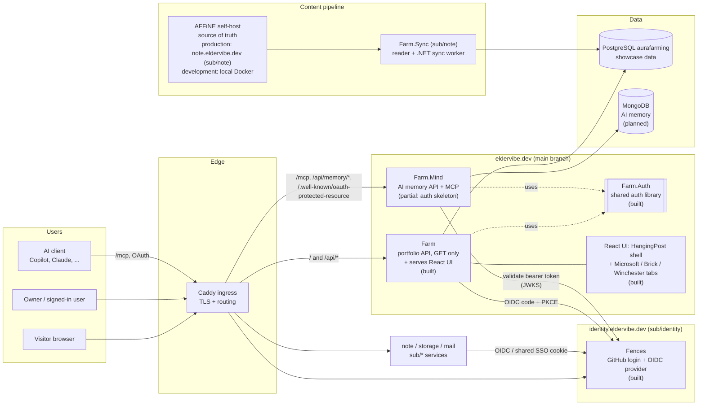
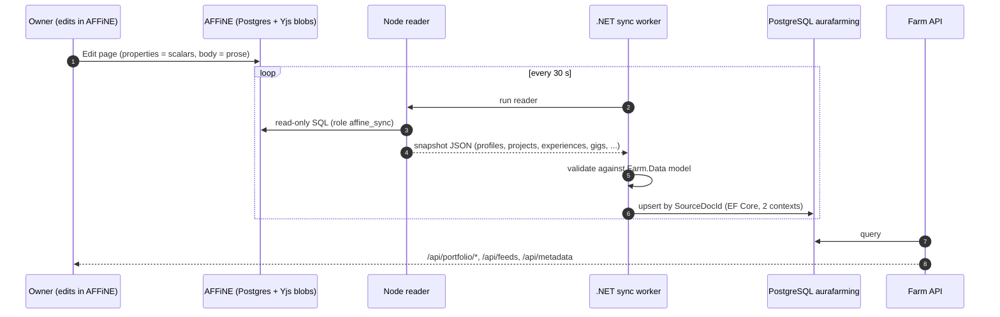
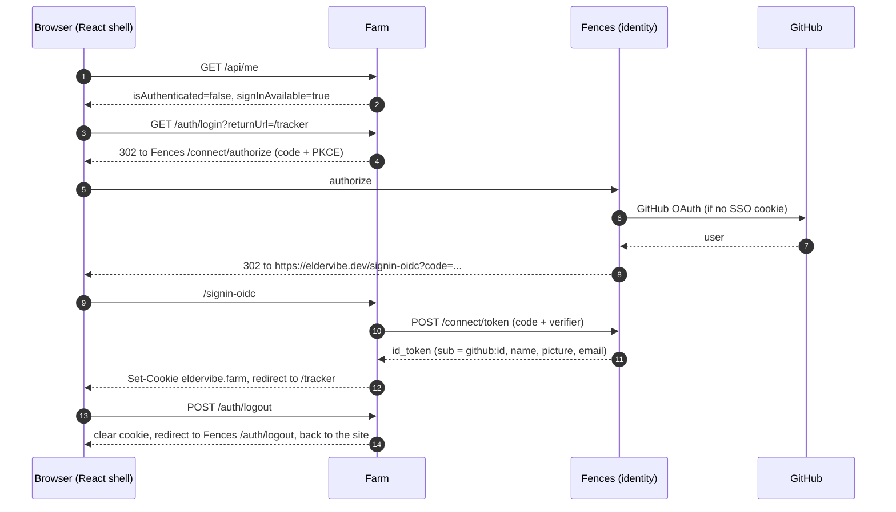
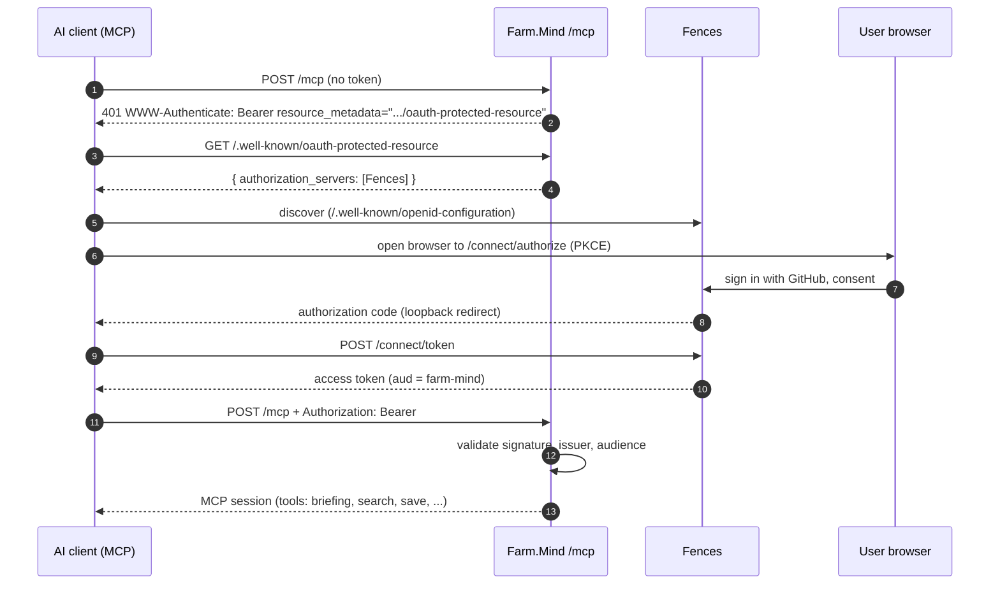
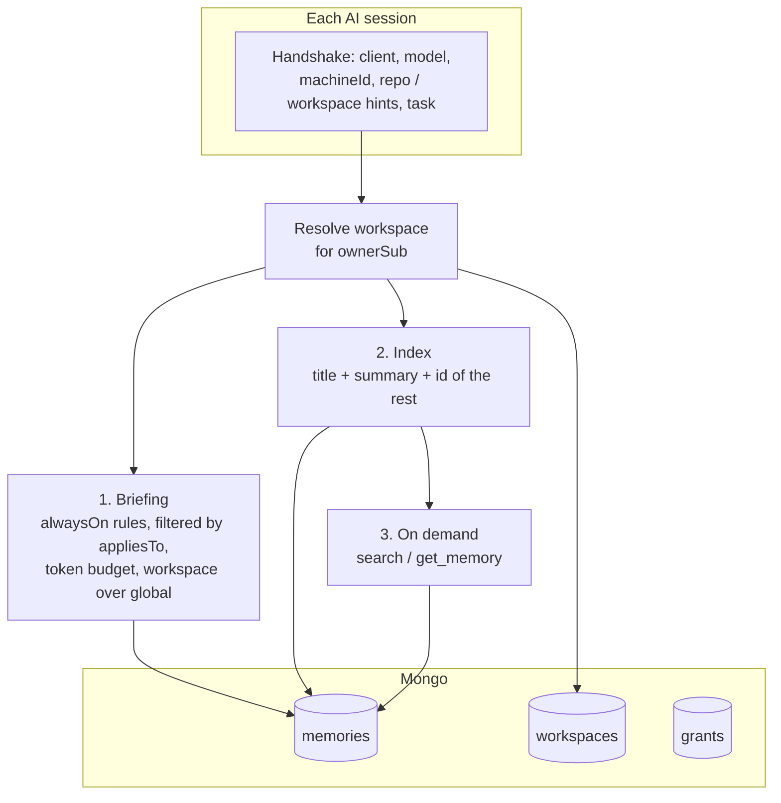
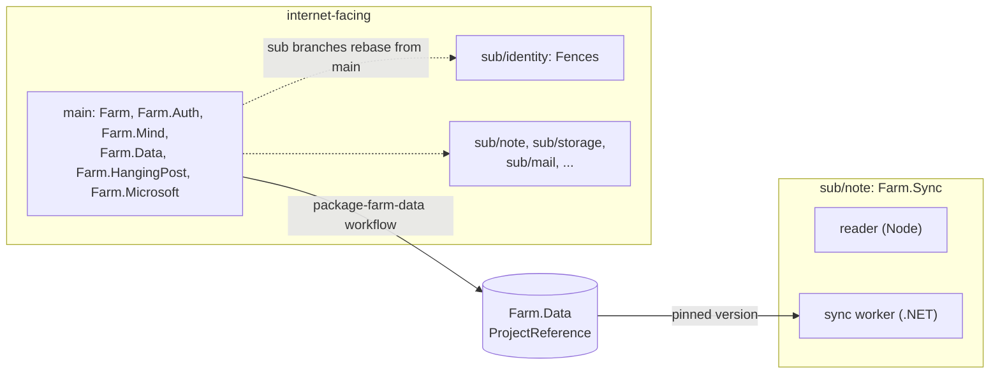

# eldervibe.dev - system overview

How the pieces around eldervibe.dev connect. Status legend: **built** = running today, **partial** = skeleton or
wiring exists, **planned** = decided in `DISCUSSION-NOTES.md`, not started.

## 1. Big picture

## 2. Two projects, one auth flow

| Project | Role | Access | Data | Status |
|---|---|---|---|---|
| `Farm` | Introduction and showcase: profile, projects, skills, experiences, feeds, social links. Hosts the React UI. | Public, read-only (`GET`). Only `/auth/*` and `/api/me` involve sign-in. | PostgreSQL (`Farm.Data`) | built |
| `Farm.Mind` | The vibe-coder area: personal AI memory, MCP server, REST for the UI. | Authenticated, read/write. | MongoDB | skeleton |
| `Farm.Auth` | Shared library: session cookie, OIDC sign-in, bearer validation, resource metadata. | n/a | n/a | built |

Both services share the same session cookie name and Data Protection key ring (a shared volume), so a browser
session created through `Farm` is also accepted by `Farm.Mind`. MCP clients send a bearer token instead.

## 3. Content pipeline (AFFiNE to PostgreSQL)

Environments: **production AFFiNE is `note.eldervibe.dev`**, deployed from the `sub/note` branch (AFFiNE submodule
`Streams/DaHang`, compose from `.docker/selfhost`). The AFFiNE container stack run locally (`affine-local/affine`) is
the **development** instance only.

Rules: one AFFiNE page = one record, a `Kind` property selects the entity, the page body fills the description
(Bio, Description, Gig `Problem` / `Outcome` / `Steps`). `Farm.Data` owns the schema. Deletes will be soft
(`DeletedAtUtc`, planned).

## 4. Browser sign-in (Farm UI)

## 5. MCP web login (AI client)

The browser login is started by the AI client, not by the website. The website only shows the endpoint
(`/connect` page).

Done: protected resource metadata, 401 challenge with the metadata hint, bearer validation, and `/mcp` as a
placeholder (returns 501 once authenticated). Needed in Fences before this works end to end: see section 8.

## 6. AI memory model (draft)

Future: a pipe from MongoDB to AFFiNE so the user can view and edit memories there (decision 8), then two-way sync.

## 7. Auth building blocks (`Farm.Auth`)

| Piece | Used by | Purpose |
|---|---|---|
| `AddFarmBrowserAuth` | Farm | Session cookie plus OIDC code + PKCE against Fences. Off when `FarmAuth:Authority` is blank. |
| `AddFarmApiAuth` | Farm.Mind | Cookie or bearer token; 401 instead of redirects; `FarmUser` and `FarmMcp` policies. |
| `MapFarmAuthEndpoints` | Farm | `GET /auth/login`, `POST /auth/logout`, `GET /api/me`. |
| `MapProtectedResourceMetadata` | Farm.Mind | RFC 9728 discovery for MCP clients. |
| `ReturnUrl.Sanitize` | both | Local paths only, so no open redirects. |

Configuration (`FarmAuth` section, env `FarmAuth__*`): `Authority`, `ClientId`, `ClientSecret`, `Audience`
(default `farm-mind`), `PublicBaseUrl`, `CookieName`, `CookieDomain`, `DataProtectionKeysPath`.

## 8. What is still needed

| Area | Item | Where |
|---|---|---|
| Fences | Register Farm as an OIDC client (redirect `https://eldervibe.dev/signin-oidc`) and an MCP public client | `FENCES_OIDC_CLIENTS_JSON` |
| Fences | Add `farm-mind` audience, disable access-token encryption (or add introspection) so `Farm.Mind` can validate | `sub/identity` |
| Fences | Client registration for MCP clients (dynamic registration, or pre-registered clients first), refresh tokens | `sub/identity` |
| Fences | Allow `eldervibe.dev` in `AllowedReturnHosts` for the logout return | `sub/identity` |
| Farm.Mind | MongoDB, memory model, REST, real MCP tools | new |
| Deployment | Dockerfile, CI and Caddy routes for `Farm.Mind`; shared key-ring volume | `deployment/`, workflows |
| Farm.Data | `DeletedAtUtc`, then a package bump | `Farm.Data` |
| UI | Padding polish with the UX plugin, per-tab navbar, Gigs tab and 3D Impala | React apps |
| Pipeline | `--check` mode against the EF model | `Farm.Sync` (sub/note) |

## 9. Repositories and branches

See also: [`ARCHITECTURE.md`](ARCHITECTURE.md) (as-built pipeline) and [`DISCUSSION-NOTES.md`](DISCUSSION-NOTES.md)
(decisions and open questions).
